<!-- Turn these on once the GitHub Action is generating real numbers:

-->

<a href="https://eliasmolato.com">[ Personal site ]</a> ·
<a href="https://oddpod.studio">[ oddPOD ]</a> ·
<a href="https://builtflow.studio">[ builtflow ]</a> ·
<a href="https://youvelop.com">[ youvelop ]</a>

